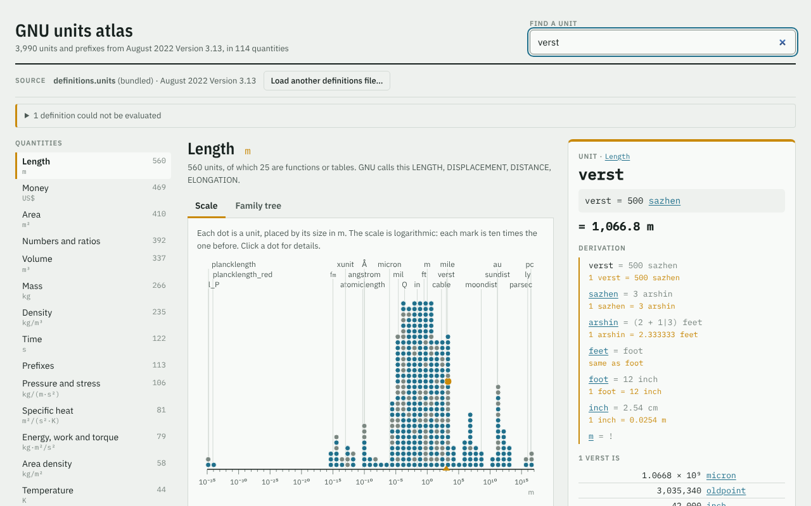
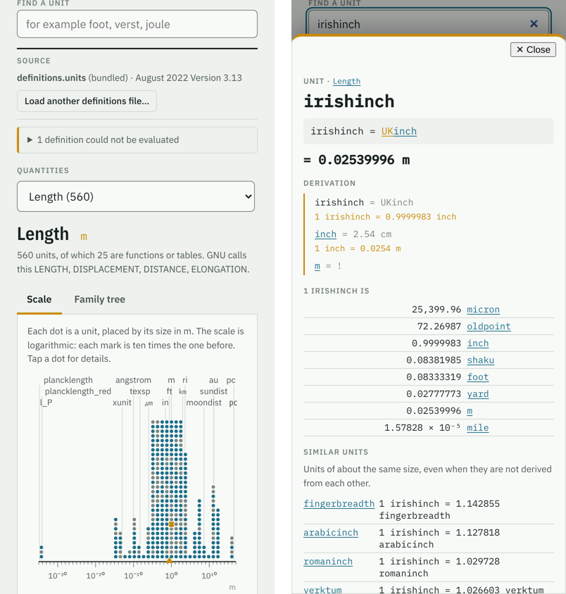

<p align="center"></p>

<h1 align="center">GNU units atlas</h1>

<p align="center">
Every unit in the <code>definitions.units</code> file of GNU units, laid out clearly:<br>
per quantity on a logarithmic scale, as a family tree, and per unit with its derivation and ratios.
</p>

<p align="center">


</p>



[GNU units](https://www.gnu.org/software/units/) knows almost 4000 units, from the Planck length to the light year and from the Roman foot to the Irish gallon. They all live in one text file, `definitions.units`, where each unit is defined in terms of others. This atlas makes that file searchable and visible.

## Contents

- [Using it](#using-it)
- [What's in it](#whats-in-it)
- [Loading another definitions file](#loading-another-definitions-file)
- [How it works](#how-it-works)
- [Building](#building)
- [Layout of the repository](#layout-of-the-repository)
- [Licenses](#licenses)

## Using it

**In a browser.** Open `index.html`. It is a single file with no dependencies (only the fonts come from Google Fonts; offline it falls back to system fonts). With GitHub Pages the atlas is also online: *Settings → Pages → Deploy from a branch → `main` / root*.

**On Android.** Download `UnitsAtlas.apk` from the [releases](../../releases) and install it (allow installing from unknown sources). The app works fully offline and adapts to the screen:

| Phone, portrait | Tablet, landscape |
|---|---|
| Pick a quantity from a drop-down list; a unit opens as a panel that slides up from the bottom. The back button closes the panel. | Three columns side by side: quantities, scale or family tree, and the details of the selected unit. |



## What's in it

- **Quantities.** Units are grouped by dimension (length, energy, pressure, …), with a name and the SI formula (kg·m²/s²). Quantities with only a few units can be shown on request.
- **Scale.** Every unit is a dot on a logarithmic ruler, placed by its size in the SI base unit. You see at a glance that most length units sit around the metre, and where the outliers are.
- **Family tree.** What is derived from what: under `inch` are the units defined with `inch`, and so on. With a filter and expand/collapse.
- **Unit.** For each unit:
  - the definition, with clickable units and prefixes;
  - the value in SI units;
  - the derivation chain down to the base unit, with the factor at each step;
  - a conversion table to well-known units;
  - similar units of about the same size, even when they are not derived from each other (`romaninch` and `inch`);
  - a sketch of the direct relations;
  - where the unit itself is used;
  - the comment from the file and the line number.
- **Search** by name, including plurals (`miles`) and prefixes (`kilowatt`).
- Light and dark theme, following the device setting.

## Loading another definitions file

The atlas comes with `definitions.units` version 3.13 (August 2022, GNU units 2.22). Load a newer or your own version with **Load another definitions file…** (or drop the file onto the page):

- Select `currency.units` at the same time, and any other files pulled in with `!include` (`cpi.units`, `elements.units`). If `currency.units` is missing, the bundled copy is used; other missing files are skipped. Either way the atlas tells you which.
- Definitions that cannot be evaluated are listed with file and line number.
- The loaded file is stored in the browser or app and is still there next time. **Back to the bundled version** undoes it.

The latest version is in the GNU units source at [ftp.gnu.org/gnu/units](https://ftp.gnu.org/gnu/units/).

## How it works

GNU units itself does not run in a browser, so [`src/core.js`](src/core.js) contains a JavaScript version of the units rules:

- reading the file, including `!var`, `!locale`, `!include` and lines continued with `\`;
- resolving names the way units does: the exact name first, then plurals (`s`, `es`, `ies`), then prefix plus unit, and trailing digits as a power (`m2`);
- expressions with the units precedence rules (juxtaposition binds tighter than `/`, `|` for fractions between numbers);
- functions (`tempF(x)`), tables (`wiregauge[]`) and dimensionless base units.

When the page opens it reads the bundled file and evaluates every unit, which takes less than a second. Checked against the real `units` program (version 2.23), all 3881 comparable units get the same value and dimension.

The grouping into quantities, the base unit of each quantity, the family tree (the first parent within the same quantity) and the quantity names are also worked out in `core.js`. The presentation is in [`src/template.html`](src/template.html).

## Building

**Web version.** Needs Python 3.

```sh
python3 build.py
```

This combines `src/template.html`, `src/core.js` and the files in `data/` into `index.html`, and into `android/assets/index.html` for the app (which uses the fonts in `android/assets/fonts` instead of Google Fonts). To bundle a newer `definitions.units` by default, replace the files in `data/` and build again.

**Android app.** Needs a JDK, Android SDK platform 23 (`android.jar`), `aapt`, `dalvik-exchange` (dx), `zipalign` and `apksigner`. Gradle is not used.

```sh
android/build.sh
```

The script builds the web version first and then `android/UnitsAtlas.apk`. The first time, it creates a `debug.keystore`; keep that out of the repository.

The app is a `WebView` showing the page from `assets`. [`MainActivity.java`](android/src/nl/rarevogel/unitsatlas/MainActivity.java) only adds what a `WebView` lacks by itself: a file picker for loading files, storage for the loaded file, and a back button that closes the detail panel first. The app rotates with the screen (portrait and landscape).

## Layout of the repository

```
index.html                  web version (generated by build.py)
build.py                    builds index.html and android/assets/index.html
src/template.html           layout and interaction
src/core.js                 reading and evaluating definitions.units
data/definitions.units      bundled database (GNU units 2.22)
data/currency.units         bundled exchange rates (not current)
android/                    the Android app (manifest, Java, icon, fonts, build.sh)
docs/                       images for this README
```

## Licenses

- The atlas itself: [GPL-3.0](LICENSE).
- `data/definitions.units` and `data/currency.units` come from [GNU units](https://www.gnu.org/software/units/), © Free Software Foundation, under the GPL version 3 or later.
- The IBM Plex fonts (in `android/assets/fonts`) are under the SIL Open Font License 1.1; see the `OFL-*.txt` files there.
